# MALA — 개발 일지

**~2026-05-22** 까지: 설계·VRAM PoC·리뷰는 기존 문서 그대로 ([`design-process.md`](design-process.md), [`opinion-infra-and-career.md`](opinion-infra-and-career.md), 05-19~20 트러블슈팅).

**05-23 ~ 05-27:** 로컬 구현·검증 일지 (**V1 마감 05-27**). 스크린샷 파일명의 날짜는 **이 일지의 작업일**과 맞춤 ([`demo.md`](demo.md) — 캡처 시각과 다를 수 있음).

---

## 2026-05-23 — BIOS / Docker 막힘 → 어떻게 갈 것인가

### 상황

Phase 1은 `docker compose`로 Redis를 띄우는 그림이었는데, PC에서 **Docker Desktop**이 안 떴다.

- 메시지: *Virtualization support not detected*
- BIOS에 **설정 비밀번호**가 있어 SVM(가상화)을 켤 수 없음 → 당분간 Docker 경로는 막힘

### 고민 (선택지)

| 안 | 장점 | 단점 |
|----|------|------|
| BIOS 풀고 SVM ON | compose 그대로 | 비밀번호·리스크·당장 불가 |
| Docker 없이 Redis만 | Phase 1 목표(큐)만 달성 가능 | “문서와 다른” 인프라 |
| Memurai 등 Windows Redis | 설치 간단 | 문서·팀 합의 필요 |
| **Native Redis MSI** | ADR-001과 맞음(Ollama는 이미 호스트) | compose는 “나중에 optional” |

### 왜 Native Redis로 갔는지

1. **Phase 1 Must는 “Redis 큐 1회 왕복”**이지 Docker 자체가 아님.
2. **Ollama는 처음부터 Windows 호스트** — Worker가 `127.0.0.1:11434` 호출 ([ADR-001](decisions/001-inference-engine.md)).
3. BIOS는 나중에 풀리면 **compose는 Redis만 optional**로 두면 됨 — 전체를 다시 짜지 않아도 됨.

### 결론

- **[ADR-002](decisions/002-native-redis-phase1.md):** Phase 1 = Native Redis + 호스트 Python + 호스트 Ollama  
- Redis: [tporadowski/redis](https://github.com/tporadowski/redis/releases) 설치, `redis-cli ping` → **PONG**  
- 기록: [`troubleshooting/2026-05-20-bios-docker-blocked.md`](../troubleshooting/2026-05-20-bios-docker-blocked.md)

### 오늘 한 일 (인프라만)

- 위 결정 정리 후, 큐 코드는 **“Redis가 localhost에 있다”** 전제로 설계 시작 (`BRPOPLPUSH`, JSON Envelope)

### 증빙

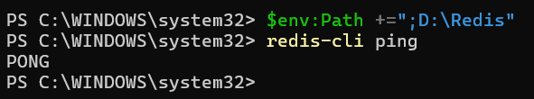

---

## 2026-05-24 — Phase 1: “메시지가 큐를 한 바퀴 도는가”

### 오늘 목표

어제 정한 경로대로 **코드 + E2E 1번**까지.

### 한 일

- `src/config.py`, `schemas/message.py`, `broker/redis_queue.py`, `worker.py`
- `scripts/check_redis.py`, `scripts/e2e_once.py`, `.env.example`, `requirements.txt`
- venv에서 `pip install`, `copy .env.example .env`
- **Worker** 한 터미널, **e2e_once** 한 터미널 → `--- E2E SUCCESS ---` (`TASK-a7525fce`, `qwen3:8b`)

### 배운 점

- 에이전트끼리 HTTP로 붙이지 않고 **Redis List + JSON Envelope**로만 통신 ([`architecture.md`](architecture.md))
- `BRPOPLPUSH`로 processing 큐에 걸린 메시지도 복구 가능하게 설계

### 증빙

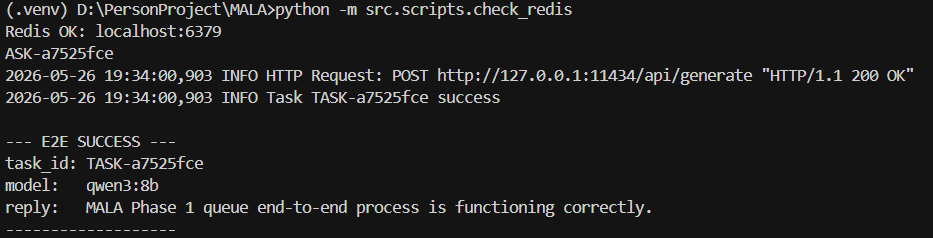

---

## 2026-05-25 — Phase 2: LangGraph + “뇌가 비어 있으면 환각한다”

### 오늘 목표

큐 위에 **오케스트레이터** 얹기. 진행 상태는 Redis Hash로 조회.

### 한 일

- `src/agents/` — `route` → `retrieve`(스텁) → `answer` → `validate` (재시도 상한)
- `task_status:{task_id}`, `run_graph_once.py`, `show_task_status.py`
- `recommend_model.py` — 3080 + 32GB면 `hybrid` 힌트 (`nvidia-smi` 폴백)
- **GRAPH SUCCESS** (`TASK-a4cdc28b`) — Worker + `run_graph_once` 2터미널

### 배운 점 (중요)

- `qwen3:8b`만 넣고 “MALA Phase 2 설명해줘” → **하이퍼파라미터 튜닝** 같은 엉뚱한 답  
  → 파이프라인은 맞는데 **지식(Context)이 비어 있음**을 확인 → Phase 3 RAG 동기 부여

### 증빙

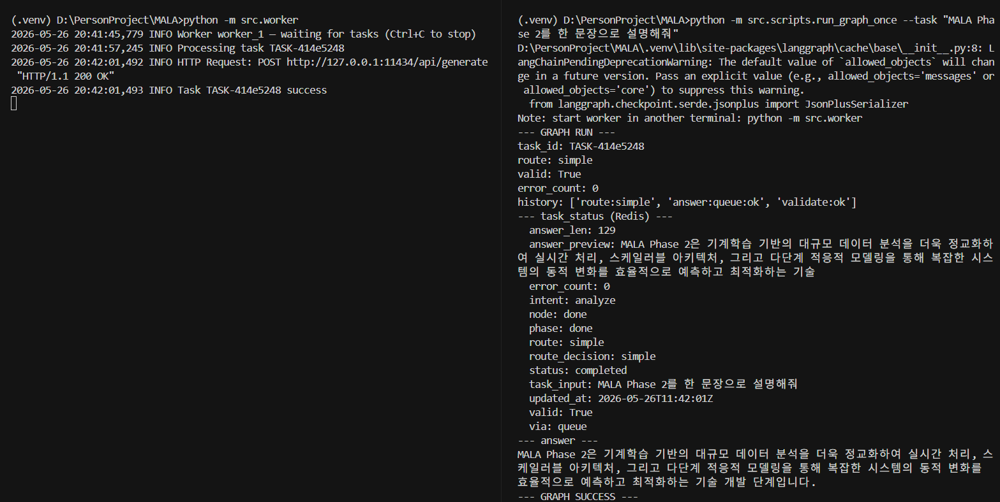  
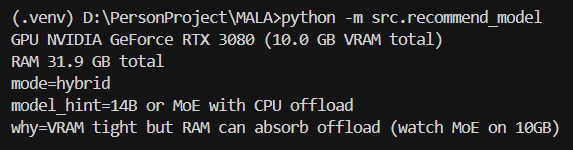

---

## 2026-05-26 — Phase 3: RAG + V1 마감 + 실제 Obsidian 볼트

### 오늘 목표

`vault_sample` RAG 검증 후, **D:\Ob\Vault** 실제 Obsidian 볼트 연동.

### 한 일 (구현)

| 구간 | 내용 |
|------|------|
| 오전 | `retrieval/` chunker, manifest, Chroma, Ollama `nomic-embed-text`, `vault_sample/`, `build_index` |
| 오후 | `retrieve` 노드 연동, `worker` 프롬프트에 context 주입, `rag_once` |
| 마감 | 검색 **rerank**(Phase-2 문서 적중), stub 문구 수정·재인덱스, **DLQ**·`verify_incremental --count 100` |

### 검증 로그

- 인덱스: `updated=1`, `skipped_unchanged=2` (3파일 중 1개만 변경)
- 100파일: **99 unchanged, 1 updated**
- RAG (샘플): **RAG SUCCESS** (`TASK-3458907b`) — `Phase-2-Agent.md` 기준
- Obsidian `D:\Ob\Vault`: `build_index` (1 note), **RAG SUCCESS** (`TASK-4860f95a`) — `환영합니다!.md`

### 증빙

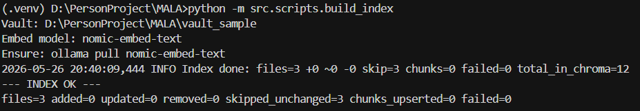  
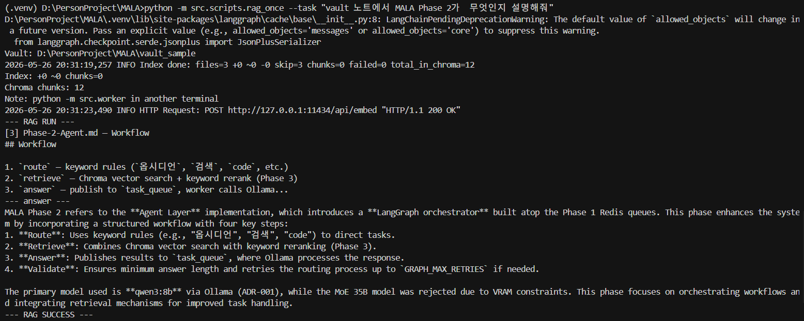  
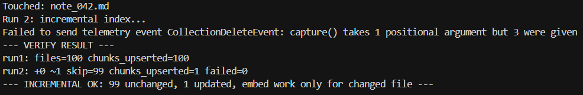  
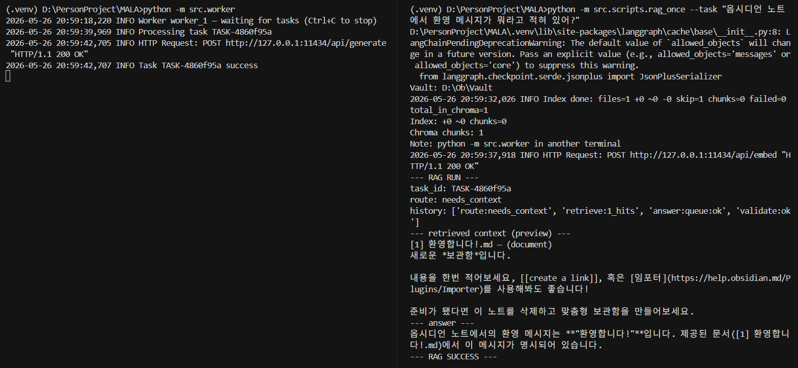 — A/B 터미널 (`TASK-4860f95a`)

### 저녁 — Ollama 모델 경로 (D:) + Phase 4 준비

**배경:** C 드라이브 여유 확보, Phase 4용 `hermes3:8b` pull.

| 구간 | 내용 |
|------|------|
| 설정 | `OLLAMA_MODELS=D:\ollama\models` (시스템 변수), 기존 `models` → D 복사 |
| 막힘 | **재부팅·Quit 후에도** `server.log`에 `OLLAMA_MODELS` = **C** 고정 |
| 원인 | Ollama **0.24** — `%LOCALAPPDATA%\Ollama\db.sqlite` `settings.models`가 C로 저장됨 (env보다 우선) |
| 조치 | DB `models` → `D:\ollama\models` 수정 · 트레이 Quit 후 재시작으로 로그 재확인 · 필요 시 C→D **junction** |

- `hermes3:8b` pull 완료 (~4.7 GB), `ollama list` 3모델
- C `models` → `models_old` 후 **`rmdir`** — `server.log`에 `OLLAMA_MODELS:D:\ollama\models` 확인
- 상세: [`troubleshooting/2026-05-26-ollama-models-path-windows.md`](../troubleshooting/2026-05-26-ollama-models-path-windows.md)

### 밤 — Phase 4: Hermes 라우터 PoC

| 구간 | 내용 |
|------|------|
| 설정 | `.env` — `USE_HERMES_ROUTER=1`, `OLLAMA_ROUTER_MODEL=hermes3:8b`, `MAX_TOOL_STEPS=5` |
| 코드 | `hermes_router.py`, `run_hermes_once.py`, `measure_router_vram.py`, `check_paths` |
| 막힘 1 | Hermes가 **`search_vault` tool 미호출** → Qwen만 답 → 환각 (`Opacity Notes` 등) |
| 조치 | **키워드 폴백** (`fallback_vault_query`) — vault형 질문이면 Chroma 검색 강제 · OOD(월드컵)는 제외 |
| 막힘 2 | Chroma **telemetry ERROR** (posthog) — RAG 무관, `chroma_store.py`에서 로그 억제 |
| VRAM | Hermes **단독** peak **7418 MiB** / 10240 · `ollama ps` **5.2 GB** — [`model-comparison.md`](model-comparison.md) |

### 검증 로그 (Phase 4)

- `check_paths` — PREFLIGHT OK, `USE_HERMES: True`
- `run_hermes_once --ood` — **OOD OK** (`TASK-9a2e30e5`), `search_vault` 없음
- `run_hermes_once` (vault) — **HERMES SUCCESS** (`TASK-6ae4de11`, `TASK-8f744eba`)
  - `route: needs_context` · `hermes:fallback_search:1_hits` · context `환영합니다!.md`
  - 답: **"환영합니다!"** (볼트와 일치)

### 증빙

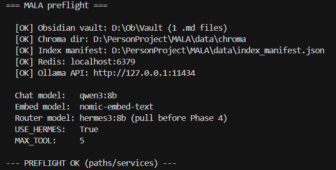  
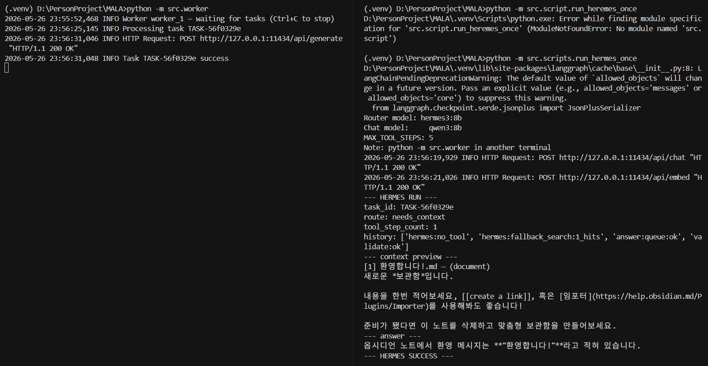 — `TASK-8f744eba`  
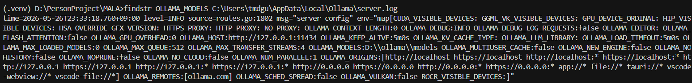

### 메모

- VRAM PoC(Qwen peak)는 **05-20** — [`assets/2026-05-20-vram-peak.png`](assets/2026-05-20-vram-peak.png)
- Phase 4 결정·PoC: [`decisions/003-phase4-hermes-router.md`](decisions/003-phase4-hermes-router.md)
- Hermes **네이티브 tool 호출**은 PoC 이후 개선 (현재 폴백으로 RAG 보장)

---

## 2026-05-27 — V1 마감 점검

### 오늘 목표

26일 PoC **동작 재확인** 후 V1 종료 — **SQLD(05-31)** 집중.

### 스모크 결과

| 항목 | 결과 |
|------|------|
| `check_paths` | PREFLIGHT OK · `USE_HERMES: True` |
| `pytest tests` | **17 passed** |
| `run_hermes_once` | **HERMES SUCCESS** (`TASK-a9198b0e`) — `fallback_search:1_hits`, `validate:ok` |
| `run_hermes_once --ood` | **OOD OK** (`TASK-9546711b`) — `hermes:no_tool`, vault 검색 없음 |

### 마감 조치

- `run_hermes_once.py` — Windows CMD(cp949) **Unicode 출력** 폴백 (`_safe_print`)
- **V1 선언** — Phase 0~4 PoC 완료 (Claude/Cursor 합의). 이후: 데모 스크립트 정리·UI는 **SQLD 이후**

### 메모

- 면접·이력서: **파이프라인 E2E 증명** · Hermes는 **폴백 RAG 그라운딩**으로 기술 (대규모 KB·완전 FC 아님)

---

## 2026-10-28~29 — 0단계 기준선

### 한 일

- 평가 스크립트(`eval_run`)로 기준선 측정. 대상은 `docs/` 고정 사본 ([ADR-004](decisions/004-eval-docs-snapshot.md)).
- 질문 20개(노트에 있음 15, 없음 5) x 2회. `qwen3:8b`, `nomic-embed-text`, TOP_K 3.
- 사람 판정을 정하고, 모델 없이 다시 채점하는 `eval_rescore` 추가.
- q08 기대 출처에 `study/00-MALA-study-guide.md` 추가 (같은 내용이 있음).
- 질문, 결과, 사람 판정을 `eval/`에 올림. 다른 PC에서도 재채점 가능.

### 기준선 (재채점)

`eval/results/20261028-2205_baseline-docs_rescored.md`에서 옮김. 비율은 1회차 기준.

| 지표 | 값 |
|------|----|
| 정답률 (사람 판정 우선) | 45% (9/20) |
| 노트에 있는 질문 | 27% (4/15) |
| 노트에 없는 질문에 '모른다' | 100% (5/5) |
| 출처 일치율 | 53% (8/15) |
| 2회 전체 정답률 | 42% (17/40) |
| 반복 시 판정이 같은 비율 | 95% |

재채점 전에는 정답률 45%, 출처 일치율 47%였다. 바뀐 것은 두 문항이다. q08은 출처가 맞게 잡히고 사람 판정 O. q03은 사람 판정 X. 그래서 정답률은 같다.

시간과 토큰은 원래 결과(`20261028-2205_baseline-docs.md`)의 값이다. 응답 시간 중앙값 8,128ms, 최대 58,283ms(첫 문항, 모델 로드 32,706ms 포함). 입력 토큰 평균 511, 출력 토큰 평균 404. 2회 답이 글자까지 같은 비율은 10%.

### 판정 규칙

- in_notes: 키워드가 있어도 결론이 "모른다/확인할 수 없다"면 X. (q03이 이 경우)
- not_in_notes: 문서에 없는 값을 실측처럼 말하면 X. (q18 2회차)

### 발견한 것

- 출처 일치율은 파일 단위라 검색 품질을 실제보다 좋게 보여준다. 출처가 맞았는데 틀린 문항이 5개다 (q01, q03, q05, q12, q15).
  - q01, q05, q12, q15: 맞는 파일에서 제목만 있는 짧은 청크(24~178자)를 가져왔다. 답이 든 절은 프롬프트에 없었다.
  - q03: 맞는 파일(`scope.md`)에서 가져온 청크는 성공 기준 절이라 라우터 이야기가 없었다. 같이 들어온 study-guide 청크에 "Hermes"는 있었지만 `tool_calls` 이야기였고, `hermes3` 모델 이름은 세 청크 어디에도 없었다. "모른다"는 받은 내용으로는 맞는 답이었다.
  - 10-29에 같은 평가 색인으로 다시 검색해 확인했다. 다섯 문항 모두 출처 목록이 기준선과 같았다.
- 1회차 검색 결과 60개 중 19개가 `study/00-MALA-study-guide.md`다. 20문항 중 12문항에 이 문서가 들어왔다.
- 검색 결과는 1·2회차가 같았고, 답 글자는 10%만 같았다. 흔들림은 검색이 아니라 생성 쪽이다 (fix-later 2번).
- 출력 토큰에 thinking 토큰이 섞여 있고, 평가 도구가 따로 못 센다 (fix-later 7번에 추가).
- `nomic-embed-text` 필수 접두어(`search_query:`, `search_document:`)를 안 붙이고 있다 (fix-later 17번).
- 자동 판정이 "모릅니다"를 못 잡고, in_notes에서 '모른다'로 끝난 답을 O로 셀 수 있다 (fix-later 18번).

### eMudhra 인증서 침해 대응 (10-29)

시험 주소: `https://dv-g3b-emudhra.we-have-a-problem.com/` (인증서 오류가 나야 안전)

| 대상 | 고치기 전 | 조치 | 고친 뒤 |
|------|-----------|------|---------|
| Git | 2.45.1(openssl), 접속됨 ("not valid: is this a git repository?") | 2.56.0.windows.4로 업데이트, `http.sslBackend=schannel`(전역) | `CRYPT_E_REVOKED` |
| venv httpx | 200 | certifi 2026.10.23, pip 26.2.2 | `CERTIFICATE_VERIFY_FAILED` |
| 시스템 파이썬 | - | pip 26.2.2 | - |
| 윈도우 저장소 (curl.exe) | 처음부터 `CRYPT_E_REVOKED` | - | - |

- `requirements.txt`에 `certifi>=2026.10.19` 추가.
- Claude Code 2.1.312는 이미 고친 버전.
- 고친 뒤 pypi.org 200, GitHub fetch 정상.
- `pytest`: 39 passed.

---

## 2026-10-29 — 1단계 시작: 검색만 재기, 질문 라벨 v2

### 한 일

- `eval_run --retrieval-only`: 답변 모델 없이 검색만 잰다. in_notes 15문항 x 1회.
- 지표 추가: 답 근거 청크 포함률. 기대 출처 파일의 청크 하나에 `must_include`가 다 있는지(주 지표), 아무 청크든 있는지. 프롬프트에 실제로 들어가는 글(본문 1200자까지)로 판정.
- 스위치 `RAG_RERANK=keyword|off`. 기본 `keyword`는 지금 동작 그대로.
- `eval/env_docs.ps1`에 기준선 때 값(모델, 임베딩, `GRAPH_MAX_RETRIES`, `RAG_TOP_K`, `RAG_RERANK`)을 고정. 동작은 같다.
- 기준선 조건(TOP_K 3, keyword)에서 파일 단위 출처 일치율 53%(8/15) 재현. 15문항의 출처 목록이 기준선과 같았다.
- 질문 라벨 v2: 답이 그 줄에 직접 있는 문서를 기대 출처에 추가(8문항), `must_include`에 같은 뜻의 다른 표기 허용(q04, q07, q08). 1단계 실험 중에는 라벨을 바꾸지 않는다.

### v1 / v2 비교

답변 (기준선 재채점, 1회차 기준, 모델 다시 안 돌림)

| 지표 | v1 | v2 |
|------|----|----|
| 정답률 (사람 판정 우선) | 45% (9/20) | 45% (9/20) |
| 정답률 (자동 판정) | 45% | 50% |
| 노트에 있는 질문 | 27% (4/15) | 27% (4/15) |
| 출처 일치율 (파일) | 53% (8/15) | 80% (12/15) |

검색 (`--retrieval-only`, in_notes 15문항)

| TOP_K | rerank | 근거 청크 (기대 출처) v1 → v2 | 근거 청크 (아무 청크) v1 → v2 | 출처 일치 (파일) v1 → v2 | 200자 미만 청크 |
|---|---|---|---|---|---|
| 3 | keyword | 13% (2) → 27% (4) | 27% (4) → 33% (5) | 53% (8) → 80% (12) | 76% (34/45) |
| 3 | off | 7% (1) → 7% (1) | 7% (1) → 7% (1) | 47% (7) → 73% (11) | 84% (38/45) |
| 5 | keyword | 33% (5) → 40% (6) | 33% (5) → 40% (6) | 67% (10) → 87% (13) | 71% (53/75) |
| 5 | off | 7% (1) → 13% (2) | 27% (4) → 27% (4) | 53% (8) → 80% (12) | 81% (61/75) |

v1과 v2는 가져온 청크가 같고 라벨만 다르다. 오른 몫은 검색이 좋아진 게 아니라 채점 기준을 바로잡은 몫이다.

### 발견한 것

- 파일 단위 출처 일치율(80%)과 근거 청크 포함률(27%) 차이가 크다. 맞는 파일에서 답이 없는 청크를 가져오는 경우가 많다.
- 가져온 청크의 4분의 3이 200자 미만이다. 제목만 있는 짧은 청크가 위로 올라온다.
- rerank를 끄면 나빠진다(근거 27% → 7%, v2). 지금은 키워드 점수가 짧은 청크 문제를 일부 가려 주고 있다 (fix-later 9번에 기록).
- TOP_K 5는 근거가 늘지만(27% → 40%), 프롬프트가 길어진다. 답 품질과 시간은 아직 재지 않았다.
- 결과 파일 머리의 "src에 커밋 안 된 변경 있음"은 이 작업을 커밋하기 전에 쟀기 때문이다. 측정 코드는 이 날 커밋한 것과 같다.

### 다음

- 다음 실험 후보: 짧은 제목 청크 합치기, nomic 접두어(fix-later 17번). 비교는 `ret-v2-k3-keyword`와 v2 재채점 기준선으로.
- `pytest`: 55 passed.

---

## 2026-10-30 — 보안 재점검 (PC·계정)

### 한 일

최신 공지(10월 윈도우 패치, NVIDIA 9-30 공지, Ollama·Claude Code 권고)를 MALA 환경과 대조했다. 코드는 Bandit, git 기록은 비밀값 패턴으로 검사했다.

| 대상 | 조치 | 확인 |
|------|------|------|
| Ollama | 클라우드 기능 끔 (`OLLAMA_NO_CLOUD=1`, `server.json`) | 로그 `Ollama cloud disabled: true` |
| Ollama | 다시 켤 때 자동 업데이트 0.40.11 → 0.40.13 | 검색 평가 재확인 (아래) |
| Claude Code | npm 설치 → 네이티브 설치 2.1.314 | `claude doctor`: native |
| GitHub | 2FA, 커밋 이메일 noreply, Dependabot 알림, 비밀값 push 차단 | 설정 화면 |
| 윈도우 업데이트, GPU 드라이버 | 확인만 (이미 최신) | - |

- Bandit: 높음·중간 0건. git 기록 비밀값: 0건.
- 검색 평가 재확인 (`ret-v2-k3-keyword` 조건): 27% (4/15), 33% (5/15), 80% (12/15), 76% (34/45). 15문항 모두 가져온 청크가 기준선과 같았다. 확인용이라 결과 파일은 올리지 않았다.

### 발견한 것

- Ollama는 다시 켤 때 스스로 업데이트한다. 평가 환경이 말없이 바뀔 수 있는데, 결과 파일 머리에 Ollama 버전과 모델 ID가 없다 (fix-later 19번).
- Claude Code npm 설치는 10-28부터 자동 업데이트가 조용히 실패하고 있었다 (`install_failed`). 네이티브로 옮기면서 풀렸다.
- 환경변수를 넣은 직후에는 Ollama 로그가 계속 false였다. `server.json`을 더하고 다시 켜니 true가 됐다. 어느 쪽이 적용됐는지는 구분하지 못해서 둘 다 둔다.
- Dependabot 알림은 0건이다. requirements.txt에는 범위만 있어서 GitHub이 실제 버전을 모른다. 의존성 점검은 로컬에서 실제 설치 버전으로 한다.

### 다음

- 임베딩 접두어 실험 (fix-later 17번).

---

## 2026-10-30 — 1단계: 임베딩 접두어 (fix-later 17번)

### 한 일

- fix-later 19번 수정: 결과 `.md` 머리와 jsonl(`run_env`)에 Ollama 버전, 답변·임베딩 모델 digest, 임베딩 접두어를 남긴다. Ollama에 연결이 안 되면 "알 수 없음"으로 적고 계속한다.
- 스위치 `EMBED_PREFIX=off|nomic`. 기본 off는 지금 동작 그대로. nomic이면 색인에 `search_document: `, 검색에 `search_query: `를 붙인다. Chroma 0.6은 임베딩 함수에 문서/질문 구분을 넘기지 않아서, 벡터를 직접 만들어 넘긴다. 저장 원문에는 접두어가 없다.
- 접두어 방식이 다른 컬렉션을 열면 오류가 나게 했다 (컬렉션 메타데이터 `embed_prefix`, 키가 없으면 off로 본다).
- 평가 전용 색인 `mala_eval_docs_prefix`를 새로 만들었다 (`eval/env_docs_prefix.ps1`, 매니페스트·실패 기록도 새 파일). `env_docs.ps1`에는 `EMBED_PREFIX = "off"`를 넣어, 같은 창에서도 기준선으로 돌아오게 했다.
- `pytest`: 69 passed.

### 결과 (`--retrieval-only`, in_notes 15문항, 기준선 → 접두어)

| 지표 | k3 keyword | k3 off |
|---|---|---|
| 근거 청크 (기대 출처, 주 지표) | 27% (4) → 53% (8) | 7% (1) → 20% (3) |
| 근거 청크 (아무 청크) | 33% (5) → 60% (9) | 7% (1) → 27% (4) |
| 출처 일치 (파일) | 80% (12) → 87% (13) | 73% (11) → 73% (11) |
| 200자 미만 청크 | 76% (34/45) → 42% (19/45) | 84% (38/45) → 53% (24/45) |

바뀐 문항은 fix-later 17번에 적었다.

### 확인

- 공정성: 두 색인의 청크 수(293), chunk id, 저장 원문이 모두 같다. 저장 원문에 접두어가 붙은 청크는 0개.
- 주 지표 기준(k3 keyword) 4문항 좋아짐(q02, q03, q05, q15), 0문항 나빠짐. 15문항이라 우연을 완전히 배제할 수는 없다.
- k3 off에서는 출처 일치가 q12, q14는 새로 맞고 q10, q13은 틀려져 숫자가 같다.
- 접두어를 붙여도 rerank keyword(53%)가 off(20%)보다 낫다.
- off 경로는 그대로다. `env_docs.ps1`로 keyword·off를 다시 재니 15문항 결과 행이 기준선과 글자까지 같았다 (확인용이라 결과 파일은 올리지 않음).
- 결과 머리의 digest가 `ollama list`의 ID와 같다 (Ollama 0.40.13).
- 결과 파일 머리의 "src에 커밋 안 된 변경 있음"은 이 작업을 커밋하기 전에 쟀기 때문이다. 측정 코드는 이 날 커밋한 것과 같다.

### 추정

- 짧은 청크가 줄어든 것은, 접두어로 질문·문서 벡터가 나뉘면서 제목만 있는 짧은 청크가 질문과 덜 가까워졌기 때문일 수 있다. 청크 길이 분포만 보고 한 추정이다.
- 근거 청크가 늘었으니 답변 정답률도 오를 것 같지만, 재지 않았다.

### 다음

- 접두어 색인으로 답변 평가(`--repeat 2`). 기본값 변경과 ADR은 그 결과를 본 뒤 정한다.

---

## 2026-10-30 — 답변 평가: 대조군과 접두어

### 한 일

- 답변 평가 두 번(in_notes 15 + not_in_notes 5, `--repeat 2`). 겹치지 않게 순서대로 돌렸다.
  - 접두어: `env_docs_prefix.ps1`, 라벨 `baseline-docs-prefix`.
  - 대조군: `env_docs.ps1`(접두어 off), 라벨 `baseline-docs-ctrl`. 기준선(10-28)은 Ollama 0.40.11, 지금은 0.40.13이라, 같은 날 같은 Ollama로 접두어만 뺀 조건을 따로 쟀다.
- 두 결과 모두 `eval_rescore --manual --suffix _rescored-v2`로 라벨 v2와 사람 판정을 반영했다.
- 판정 규칙을 넓혔다: in_notes 자동 O도 사람이 본다. 같은 규칙으로 기준선 q07·q09·q13도 판정했다(모두 O, 기준선 숫자는 그대로).

### 결과 (1회차 기준, '전 회차'만 모든 회차)

| | 정답률 (최종) | 정답률 (자동) | in_notes (최종) | not_in_notes (최종) | 출처 일치 | 전 회차 (최종) | 반복 시 판정 같음 | 응답 시간 중앙값 | 입력 토큰 평균 | 출력 토큰 평균 |
|---|---|---|---|---|---|---|---|---|---|---|
| 기준선 v2 (10-28, Ollama 0.40.11) | 45% | 50% | 27% (4/15) | 100% | 80% | 42% | 95% | 8,128ms | 511 | 404 |
| 대조군 (10-30, 0.40.13, 접두어 off) | 45% | 45% | 27% (4/15) | 100% | 80% | 45% | 100% | 7,324ms | 511 | 362 |
| 접두어 (10-30, 0.40.13, nomic) | 60% | 55% | 47% (7/15) | 100% | 87% | 57% | 95% | 8,190ms | 647 | 443 |

최종 판정이 다른 문항 (1회차/2회차):

| 문항 | 기준선 v2 | 대조군 | 접두어 |
|---|---|---|---|
| q02 (in_notes) | X/X | X/X | O/O |
| q03 (in_notes) | X/X | X/X | O/O |
| q05 (in_notes) | X/X | X/X | O/O |
| q18 (not_in_notes) | O/X | O/O | O/X |

나머지 16문항은 세 결과가 같다.

### 확인

- 접두어 몫 (대조군 → 접두어, 같은 날, 같은 Ollama·digest): in_notes q02, q03, q05가 X → O. 대조군만 맞힌 in_notes 문항은 없다. 3문항 좋아짐, 0문항 나빠짐.
  - 세 문항 모두 검색 평가에서 기대 출처 근거 청크가 새로 잡힌 문항이다 (q02 X → 3, q03 X → 2, q05 X → 1).
  - 검색 근거가 새로 잡혔는데 답변은 X인 문항: q15 (X → 3).
- Ollama·흔들림 몫 (기준선 → 대조군, 코드·색인 같음): q18 2회차 X → O 하나. in_notes는 15문항 모두 같다.
- q18은 대조군 O/O, 접두어 O/X. 접두어 2회차가 추정값을 단정했다. 1회차 기준 지표에는 차이가 없고 '전 회차'와 '반복 시 판정 같음'에만 반영된다.
- 비용 (대조군 → 접두어): 입력 토큰 평균 511 → 647, 출력 토큰 평균 362 → 443, 응답 시간 중앙값 7,324ms → 8,190ms.
- 최대 응답 시간은 비용 비교에 쓰지 않는다. 접두어 최대 39,265ms는 첫 문항(q01 1회차)이라 모델 로드(load_ms 11,890)가 섞였고, 대조군(최대 10,352ms, q01 1회차 load_ms 6)은 접두어 직후라 모델이 이미 올라와 있었다. 기준선 최대 58,283ms도 첫 문항(q01 1회차, load_ms 32,706)이었다.
  - 다만 로드를 빼도 접두어 q01 1회차는 27,375ms이고, 2회차도 19,051ms(load_ms 5)로 대조군 q01(10,352ms)보다 길다. 이 차이의 원인은 재지 않았다.
- 자동 판정과 사람 판정이 다른 기록: 대조군 3개, 접두어 5개. 자동 판정만 봤다면 대조군 45% 대 접두어 55%였다 (최종은 45% 대 60%).

### 판정 방법

- 가림 판정 1 (22건): 두 결과에서 '모른다' 계열 표현이 있는 답 중 fix-later 18번에 걸리는 것(in_notes 자동 O, not_in_notes)을 섞어 B 번호로 판정. 자동과 다른 판정 5건.
- 가림 판정 2 (22건): 아직 사람이 안 본 in_notes 자동 O 전부를 섞어 C 번호로 판정. 한쪽만 자동 O인 문항은 다른 쪽 답도 넣어 항목 수로 결과가 드러나지 않게 했다. 자동과 다른 판정 0건.
- 공개 판정: 접두어 q18 (판정지 1에서 빠져 대응표 공개 뒤 판정), 대조군·접두어 q03, 기준선 q07·q09·q13.
- 판정 출처는 각 `manual.yaml` 주석에 남겼다.

### 한계

- 15문항, 반복 2회다. 접두어 몫 3문항은 우연을 완전히 배제할 수는 없다.
- 가림이 완전하지 않다. 판정지 2에 넣은 다른 쪽 답 중 "I do not know"는 같은 질문의 나머지 답과 다른 결과라는 게 드러난다.
- 판정지 1은 '모른다' 표시어로 뽑아서, 표시어 없이 값을 단정한 답(접두어 q18)과 목록에 없는 표현("명시되지 않았습니다", 대조군 q03)을 처음에 놓쳤다. 공개 판정으로 보완했다.
- 기준선 in_notes 자동 X는 사람이 다 보지 않았다. 대조군·접두어도 같다 (키워드가 없어 X라 '모른다' 처리와 무관).

### 추정

- 접두어 몫 3문항은 검색 개선(근거 청크가 새로 잡힘)이 답변까지 이어진 결과로 보인다.
- 입력 토큰과 응답 시간이 는 것은 짧은 제목 청크 대신 긴 본문 청크가 들어갔기 때문일 수 있다 (검색 평가에서 200자 미만 청크 76% → 42%).
- 답변 품질 메모: 중국어 글자 섞임 2건(C01, C13), 용어 풀이 틀림 1건(C21, SVM). 판정에는 반영하지 않았다.

### 다음

- 기본값 변경(`EMBED_PREFIX`)과 ADR은 이 결과를 근거로 따로 정한다.

---

## 5일 한눈에

| 날짜 | 한 줄 |
|------|--------|
| 05-23 | 인프라 막힘 **정리·결정** (BIOS → Native Redis) |
| 05-24 | Phase 1 **큐 E2E** |
| 05-25 | Phase 2 **LangGraph** + 리소스 진단 |
| 05-26 | Phase 3 **RAG** · **Ollama D:** · Phase 4 **Hermes PoC** |
| 05-27 | **V1 마감 스모크** → SQLD |

---

## task_id 모음

| 날짜 | Phase | task_id |
|------|-------|---------|
| 05-24 | 1 E2E | `TASK-a7525fce` |
| 05-25 | 2 Graph | `TASK-a4cdc28b` |
| 05-26 | 3 RAG (vault_sample) | `TASK-3458907b` |
| 05-26 | 3 RAG (Ob Vault) | `TASK-4860f95a` |
| 05-26 | 4 Hermes OOD | `TASK-9a2e30e5` |
| 05-26 | 4 Hermes vault+RAG | `TASK-8f744eba` (대표) · `TASK-6ae4de11` |
| 05-27 | 4 V1 smoke vault | `TASK-a9198b0e` |
| 05-27 | 4 V1 smoke OOD | `TASK-9546711b` |
